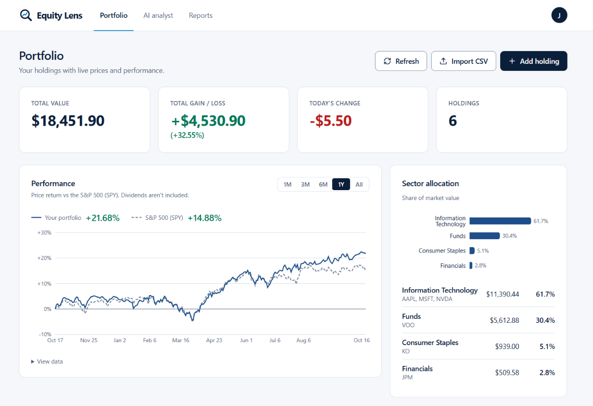
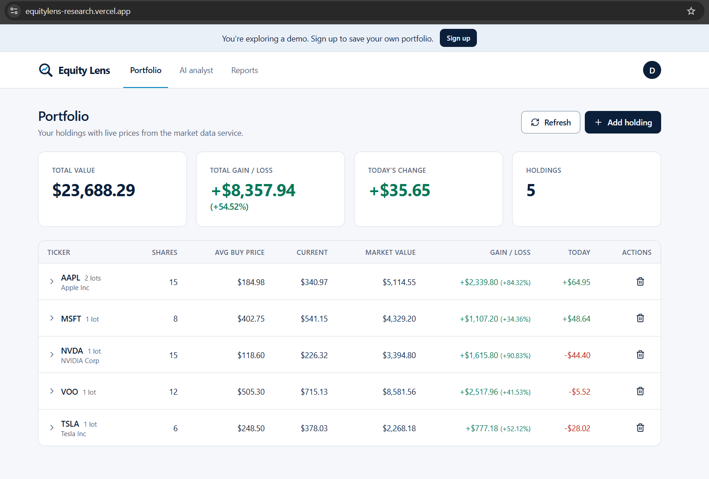
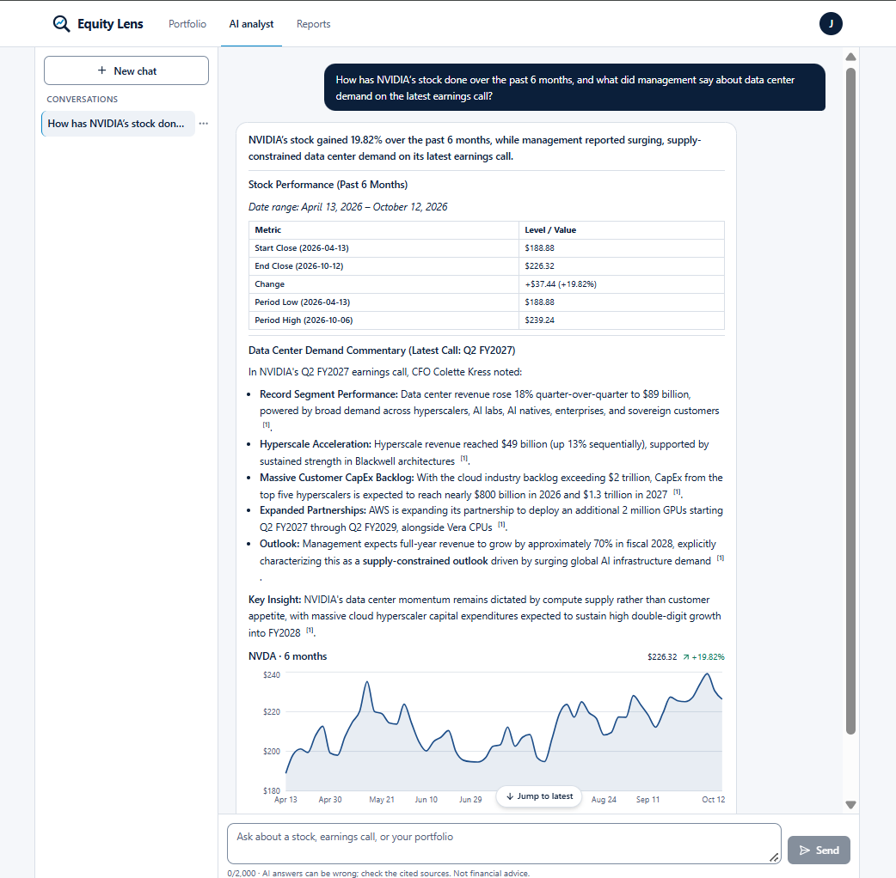
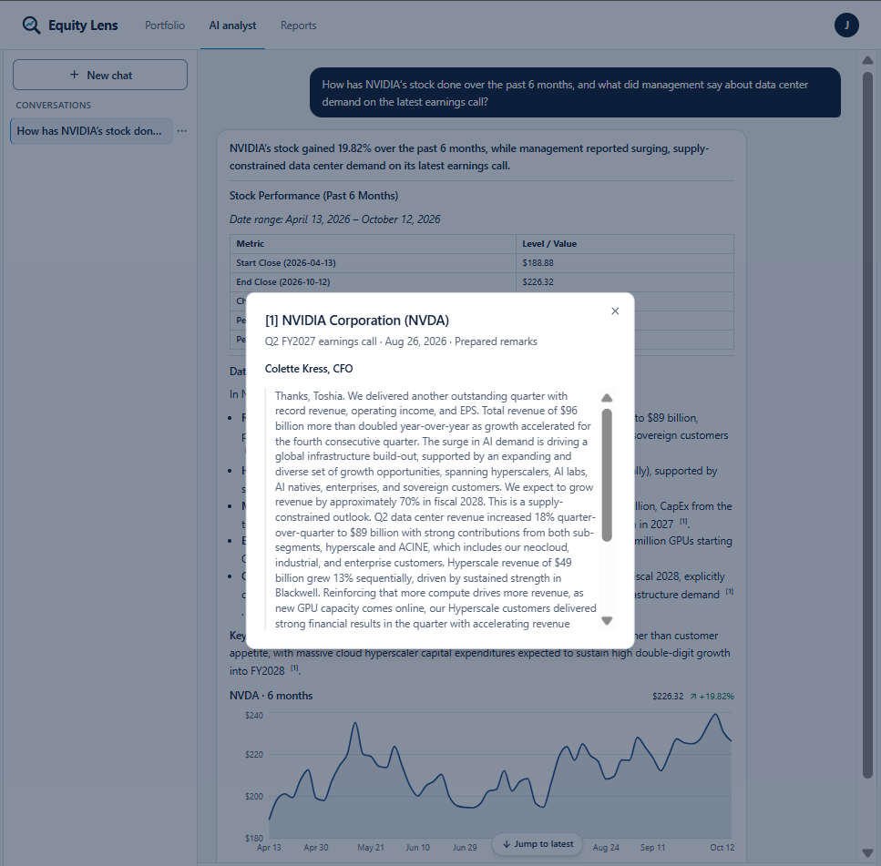
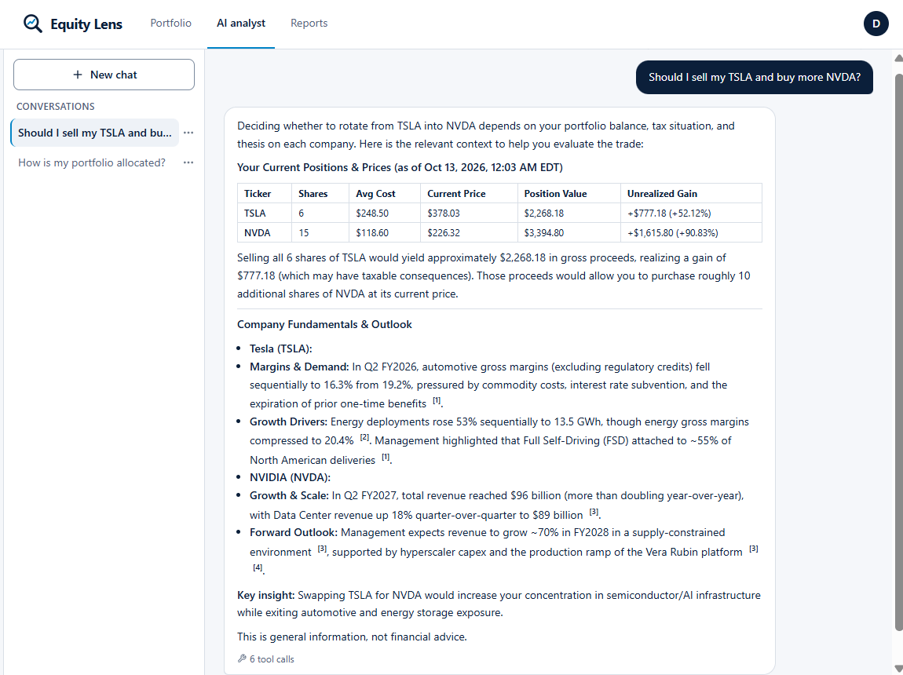
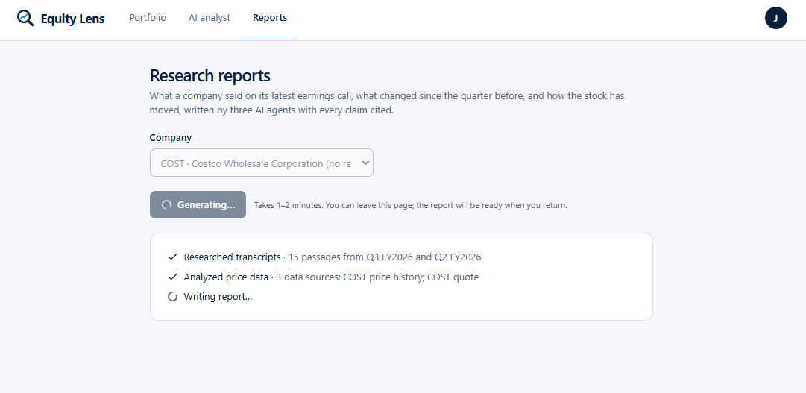
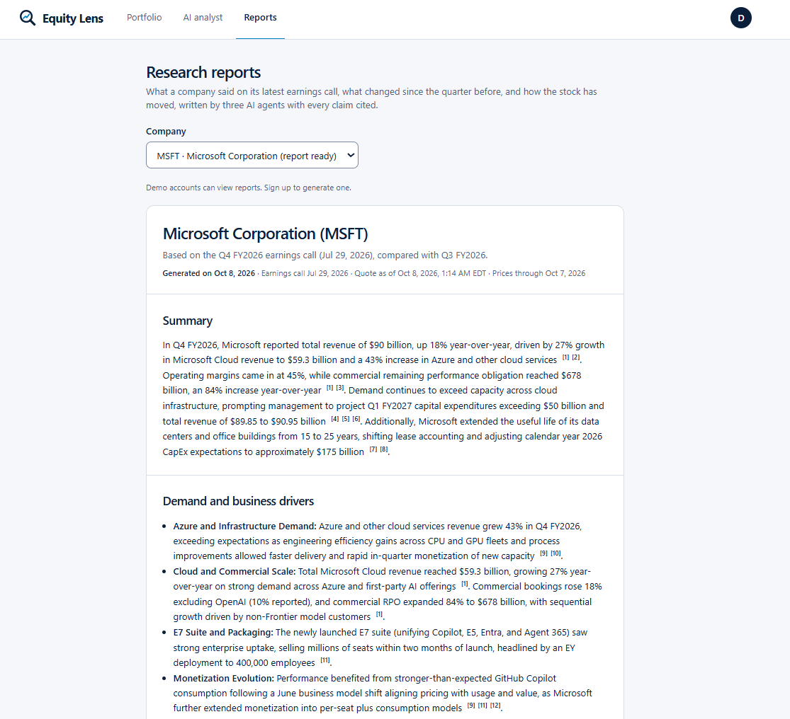
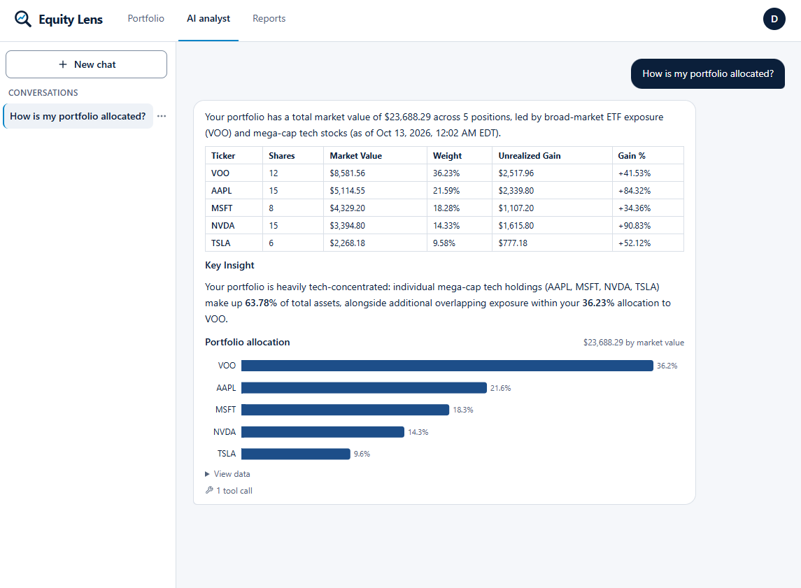
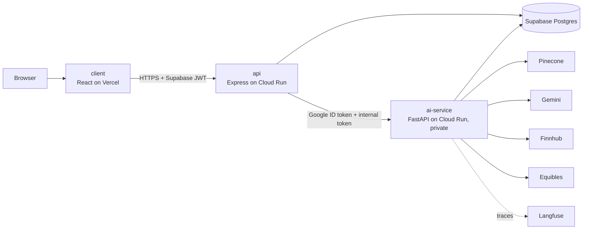
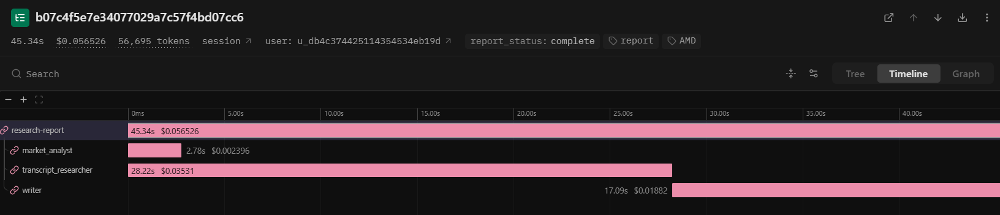

# Equity Lens

[](https://github.com/NMalpani17/equity-lens/actions/workflows/ci.yml)

AI investment research: track a portfolio and ask an analyst agent about
companies, earnings calls and your holdings, with every claim cited.

**Live demo: [equitylens-research.vercel.app](https://equitylens-research.vercel.app)**.
Click **Try demo**; no sign-up needed.

<p align="center">
  
  <br>
  <em>Performance vs the S&amp;P 500 and sector allocation.</em>
</p>

<p align="center">
  
  <br>
  <em>The portfolio dashboard: positions with live prices, gain/loss and today's change.</em>
</p>

<p align="center">
  
  <br>
  <em>An AI analyst answer with cited earnings-call passages and a price chart.</em>
</p>

## Features

- **AI analyst chat.** Streamed answers about companies, earnings calls,
  markets and your portfolio, with inline citations that open the exact
  transcript passage. A LangGraph agent calls read-only tools over MCP:
  transcript search, quotes, price history, portfolio, company and fiscal-period
  resolution, and exact position math. It gives facts and trade-offs, never
  buy/sell advice.

  <p>
    
    <br>
    <em>A citation opened to the exact transcript passage it quotes.</em>
  </p>

  <p>
    
    <br>
    <em>Facts and trade-offs instead of buy/sell advice.</em>
  </p>

- **Earnings-call search (RAG).** Hybrid dense + keyword search over each
  company's last four earnings calls, reranked, with speaker and quarter on
  every passage. New tickers are indexed on demand, and a stale ticker picks
  up its newest call in the background without slowing the answer.
- **"What changed?" comparisons.** Compares a company's latest earnings call
  with the previous one (or any two indexed quarters), theme by theme:
  guidance, demand, margins, capital allocation, risks and new initiatives,
  plus an optional focus. Each claim is cited to the quarter it describes,
  and each comparison costs at most two rerank calls.
- **Multi-agent research reports.** A Reports page with one report per
  company: summary, demand and business drivers, guidance and outlook, what
  changed vs last quarter, stock performance (with a price chart) and risks.
  A fixed LangGraph graph runs a transcript researcher (Gemini Flash) and a
  market-data analyst (Flash-Lite) in parallel, then a writer (Flash) with no
  tools. Every claim cites a transcript passage or a market-data result, and
  the report shows when it was generated and what its data is current to.
  "What changed" compares like with like (guidance with earlier guidance,
  results with earlier results) and lists results against their guidance
  under "Results vs guidance" as met, beat or missed. Guards make sure it
  always cites the earlier quarter; if it still can't, the report fails and
  isn't counted against the user. Reports are shared and cached per ticker and
  quarter, so viewing one costs nothing; signed-in users can generate 2 a day
  (about $0.06 and 45–102 s each, measured). Demo users can view the reports
  for six companies (AAPL, MSFT, NVDA, TSLA, AMD, JPM); the rest ask them to
  sign up.
  [How it works](docs/architecture.md#research-reports).

  <p>
    
    <br>
    <em>A report generating, agent by agent.</em>
  </p>

  <p>
    
    <br>
    <em>A finished research report with its dates and cited sections.</em>
  </p>

- **Charts in answers.** Price and allocation charts built only from tool data,
  never from numbers the model wrote. They stream in with the answer and are
  saved with the conversation.

  <p>
    
    <br>
    <em>An allocation chart built from portfolio tool data.</em>
  </p>

- **Portfolio tracking.** Lots grouped into positions with average cost,
  gain/loss and today's change. Live quotes come from Finnhub, with a yfinance
  fallback.
- **Performance vs the S&P 500.** A chart of the portfolio's time-weighted
  price return (no dividends) against SPY over 1M, 3M, 6M, 1Y or All. Each lot
  counts from its purchase date, so adding money never shows as a gain. Daily
  closes are cached in Postgres, so repeat loads don't refetch them.
  [How it's calculated](docs/architecture.md#portfolio-performance).
- **Sector allocation.** Market value by sector (11 GICS sectors, plus Funds
  for ETFs), from Finnhub company profiles with a yfinance fallback, cached in
  Postgres.
- **CSV import.** Upload ticker, quantity, price and purchase date for up to
  500 lots, from a downloadable template. Preview the valid rows and every
  row's errors, then save all of them or none.
- **Accounts and instant demo.** Supabase Auth with email and password or
  Google, password reset and account deletion. Forms validate as you go, and
  errors never reveal whether an email is registered. "Try demo" gives each
  visitor a private sample portfolio. Plain-language
  [Privacy](https://equitylens-research.vercel.app/privacy) and
  [Terms](https://equitylens-research.vercel.app/terms) pages are public.
- **Graceful degradation.** One failing ticker or service never breaks the
  page, and a cold AI service is woken as soon as a user signs in.

## Architecture



The React client talks only to the **api**, a public Express gateway that
verifies Supabase sessions, enforces daily limits, stores portfolios and
conversations, and streams chat over SSE. The **ai-service** owns all LLM, RAG
and market-data logic. It runs as a private Cloud Run service that only the
api's service account can invoke.

## Tech stack

| Area           | Technologies                                                         |
| -------------- | -------------------------------------------------------------------- |
| Client         | React 19, TypeScript, Vite, Tailwind CSS v4, shadcn/ui, Recharts     |
| API            | Node.js 22, Express, TypeScript, Zod, Prisma, Pino                   |
| AI service     | Python 3.12, FastAPI, LangGraph, FastMCP, Gemini, Pinecone, Pydantic |
| Data           | Supabase (Postgres, Auth), Pinecone, Equibles, Finnhub, yfinance     |
| Infrastructure | Vercel, Google Cloud Run, Artifact Registry, Secret Manager, Docker  |
| Quality        | Vitest, Pytest, ESLint, Ruff, GitHub Actions CI, Langfuse            |

Data sources: earnings call transcripts from [Equibles](https://equibles.com), live quotes and company search from [Finnhub](https://finnhub.io), and price history and fallback quotes from Yahoo Finance via yfinance.

## Engineering highlights

- **Grounded answers.** Every company claim must cite a passage retrieved in the
  same turn; citation markers that don't match a retrieved passage are dropped
  before the answer is saved. Every figure comes from a tool result, and
  position math goes through a calculator tool, never the model. On a labelled
  20-question retrieval set, the production setup (hybrid search + rerank over
  chunks with context headers) puts the right earnings call in the top 5 for
  all 20 questions, with MRR 0.94, vs hit@5 0.90 and MRR 0.71 for plain dense
  search. [Results](docs/evaluation.md#retrieval-results).
- **Evaluated with checks and a blind LLM judge.** 25 labelled questions run
  through the real agent. Each answer gets deterministic checks plus a rubric
  score from a judge that sees the answers anonymised and in shuffled order. In
  the recorded run (judge `gemini-3.1-pro-preview`), `gemini-3.8-flash` and
  `gemini-3.5-flash-lite` both passed 25/25 checks. Flash was more complete
  (5.00 vs 4.67) and was preferred 6 to 1 (11 ties); Flash-Lite cost about half
  per turn ($0.0028 vs $0.0059). Flash stays the default. Method and the
  judge-bias note are in [docs/evaluation.md](docs/evaluation.md#chat-evaluation).
  Research reports have their own eval: eleven deterministic checks per report
  (sections, citations, every figure traced to its source, both quarters cited
  in "what changed", Results vs guidance items citing both the guidance and
  the result, readable dates) plus the Pro judge. In the latest runs NVDA and
  AAPL passed 11/11 and MSFT 10/11 (the number check doesn't yet read "27
  cents" as $0.27), and the judge scored all three 5/5/5
  ([results](docs/evaluation.md#research-report-evaluation)).
- **Privacy-aware tracing.** Every chat turn and research report is traced in
  Langfuse, including agent steps, tool calls with latency, and model calls
  with tokens and cost. User ids are hashed, and portfolio values, contact
  details and secrets are masked before export. Tracing is optional and can't
  slow or break a turn.

  <p>
    
    <br>
    <em>A Langfuse trace of one report: agents in parallel, with each step's time and cost.</em>
  </p>

- **Guardrails.** Off-topic and prompt-injection requests are refused before
  the model runs. The agent gives facts rather than buy/sell advice, and daily
  per-user and global caps bound the spend.
- **Service-to-service auth.** The ai-service is deployed with
  `--no-allow-unauthenticated`. The api calls it with a cached Google ID token
  from the Cloud Run metadata server plus a separate internal-token header, and
  only the api's service account holds `roles/run.invoker`; direct calls get a 403.
- **Keyless continuous deployment.** After CI passes on `main`, GitHub
  Actions deploys only the service whose folder changed (ai-service before
  api), runs pending Prisma migrations first as a Cloud Run job, updates only
  the image, and fails unless `/api/live` returns 200. It signs in through
  Workload Identity Federation as a deployer limited to these two services, so
  there are no service account keys.
  [How it works and how to roll back](docs/deployment.md#continuous-deployment).
- **Backups and guardrails.** One environment, so production is protected
  directly: a daily keyless GitHub Action (and one before every migration)
  dumps the database (`public` + `auth`) and every Pinecone vector to a
  versioned Cloud Storage bucket with a 30-day retention policy, written by an
  identity that can't delete. Restores are tested in CI against a throwaway
  Postgres, every table has row level security, and committed Claude Code
  rules block destructive commands.
  [Backups and restore](docs/deployment.md#backups-and-restore).
- **Cold-start handling.** The ai-service can scale to zero (both services
  keep one warm instance while GCP credits last). A rate-limited
  warm-up fires after sign-in, chat streams start immediately with SSE
  keepalives and a connect timeout, and both services shut down within Cloud
  Run's 10-second grace period.

## Run locally

Prerequisites: Node.js 22+, Python 3.12+, a Supabase project, and API keys for
Finnhub, Gemini, Pinecone and Equibles.

```bash
cp client/.env.example client/.env      # then fill in each .env
cp api/.env.example api/.env
cp ai-service/.env.example ai-service/.env

npm install                             # root: Husky + concurrently
cd ai-service && python -m venv .venv && .venv/Scripts/pip install -r requirements-dev.txt && cd ..
npm --prefix api install            # tables already exist; never migrate locally
npm --prefix client install

npm run dev                             # client :5173, api :3001, ai-service :8000
```

On macOS/Linux the venv's pip is `.venv/bin/pip`. The environment variables,
Supabase setup, transcript seeding and per-service commands are in
[docs/development.md](docs/development.md).

## Documentation

- [docs/development.md](docs/development.md): local setup, configuration,
  running the services, tests and scripts
- [docs/architecture.md](docs/architecture.md): how it works: request flow,
  agent and MCP tools, RAG pipeline, citations, guardrails, tracing and security
- [docs/evaluation.md](docs/evaluation.md): retrieval and chat evals: methods,
  how to run them, and results
- [docs/api.md](docs/api.md): API reference (gateway and ai-service)
- [docs/deployment.md](docs/deployment.md): Docker images, the Vercel, Cloud
  Run and Supabase setup, and continuous deployment
